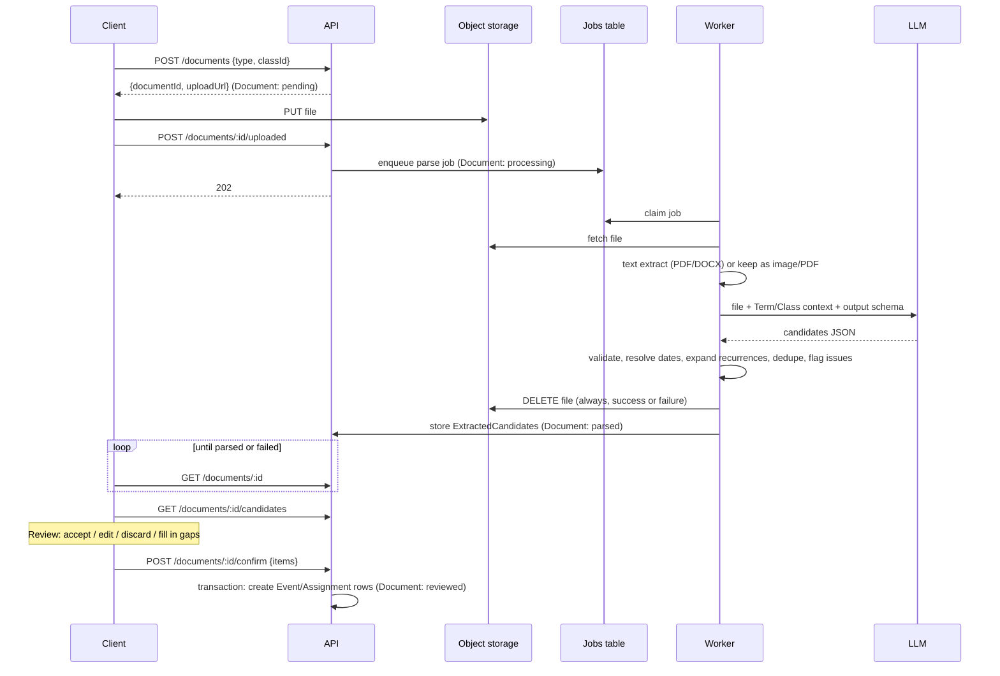

# Flow model: document upload → extracted dates

Detailed model of the flow summarized in `docs/design.md` §6. Goal: a student uploads a syllabus (or personal schedule), the system reads it and returns a reviewable list of dates for class meetings, exams/quizzes, and assignments. Nothing reaches the student's calendar until they confirm it.

## 1. Design decisions

1. **The LLM extracts what the document says; deterministic code computes dates.** The model returns structured "when" specs (absolute, recurring, relative-to-term, TBD) plus the quoted source text. Code resolves them against the Term, expands recurrences, and validates. LLMs are unreliable at calendar arithmetic ("Week 5, Tuesday"); code is not.
2. **Every candidate carries evidence and confidence.** The review card shows the source quote, so the student can verify against the document, and `issues` say exactly what is missing or uncertain. This supports "uncertainty is an invitation": the card asks the student to fill in the specific gap.
3. **Staging, not writing.** Output goes to `ExtractedCandidate` rows. Only the confirm step creates `Event`/`Assignment` rows.
4. **The document is untrusted input.** The model has no tools and no actions; its only output is schema-validated JSON. Text inside a syllabus ("ignore previous instructions...") can at worst produce a bad candidate, which the student reviews.
5. **We do not keep the uploaded file.** The less we hold, the less we must secure, and the more confidence students and parents can have. The source file exists only between upload and the end of the parse job, then it is deleted. Review works from the extracted candidates, not the original document.
6. **Class and Term context are required before parsing.** The student picks (or creates) the Class first, so the parser knows the term dates, timezone, and course name.

## 2. Sequence



## 3. Document states

```
pending ──uploaded──▶ processing ──ok──▶ parsed ──confirm──▶ reviewed
                          │
                          └──error/timeout──▶ failed ──retry──▶ processing
```

Because the file is deleted when the job ends, `failed` cannot be retried server-side: the student re-uploads. Retries inside a single job (e.g. one schema-validation retry) happen before deletion. A re-upload always creates a new Document (see open questions).

## 4. API surface

| Endpoint | Purpose |
|---|---|
| `POST /documents` | Create Document, return presigned upload URL |
| `POST /documents/:id/uploaded` | Mark upload complete, enqueue parse |
| `GET /documents/:id` | Status (poll; push notification later) |
| `GET /documents/:id/candidates` | Candidates with resolved previews and issues |
| `PATCH /documents/:id/candidates/:cid` | Student edits a candidate or fills a gap |
| `POST /documents/:id/confirm` | Commit accepted candidates in one transaction |

## 5. Extraction output schema

What the LLM returns (enforced via tool-use / structured output, then validated server-side):

```ts
type Kind = 'class_meeting' | 'exam' | 'quiz' | 'assignment' | 'other_deadline';

type When =
  | { type: 'datetime'; start: string; end?: string }            // local ISO, no offset
  | { type: 'date'; date: string; time?: string }                // due date, time often missing
  | { type: 'recurring'; days: Array<'MO'|'TU'|'WE'|'TH'|'FR'|'SA'|'SU'>;
      startTime: string; endTime: string; from?: string; until?: string; skip?: string[] }
  | { type: 'relative'; week: number; weekday?: string; time?: string }  // "Week 5, Tuesday"
  | { type: 'tbd'; note?: string };                              // "TBA", "date to be announced"

interface Candidate {
  kind: Kind;
  title: string;
  when: When;
  location?: string;
  evidence: { quote: string; page?: number };   // verbatim source text
  confidence: 'high' | 'medium' | 'low';        // model's self-report, treated as a hint only
}
```

Entity definitions for `Document`, `ParseJob` and `ExtractedCandidate` are in [`../data-model.md`](../data-model.md). The server adds, after deterministic processing:

```ts
interface ExtractedCandidate extends Candidate {
  id: string; documentId: string;
  resolved?: { start: string; end?: string; occurrences?: number; preview: string[] };
  issues: Array<'time_missing' | 'date_tbd' | 'year_inferred' | 'ambiguous_date_format'
              | 'outside_term' | 'conflicts_with_existing' | 'possible_duplicate'>;
  needsInput: boolean;      // true when the student must supply something before accepting
  status: 'pending' | 'accepted' | 'edited' | 'discarded';
}
```

`confidence` from the model is advisory. The server's own `issues` determine what is surfaced as uncertain. A candidate with no issues but low model confidence is still flagged.

## 6. Mapping to core entities (on confirm)

| Candidate | Becomes |
|---|---|
| `class_meeting`, `recurring` | `Event`, `volatility: 'stable'`, `recurrenceRule`, `source: 'parsed'` |
| `exam`, `quiz` | `Event` (start/end; a default duration is a needs-input field if the end is missing) |
| `assignment`, `other_deadline` | `Assignment` (Class is known from the upload context, satisfying the mandatory-class rule) |
| `tbd` or unresolved | Stays a candidate until the student supplies a date, or is discarded. Never silently dropped. |

Date-only deadlines have no time. Default to end of day, shown as such, and ask the student if it matters.

## 7. Worked example

Input fragment: *"Lecture: Tue/Thu 2:00–3:15 PM, Hall B. Midterm: Oct 14 in class. Paper 1 due Friday of Week 6. No class Nov 27."*

```json
[
  { "kind": "class_meeting", "title": "Lecture", "location": "Hall B",
    "when": { "type": "recurring", "days": ["TU","TH"], "startTime": "14:00", "endTime": "15:15", "skip": ["2026-11-27"] },
    "evidence": { "quote": "Lecture: Tue/Thu 2:00–3:15 PM, Hall B", "page": 1 }, "confidence": "high" },
  { "kind": "exam", "title": "Midterm",
    "when": { "type": "date", "date": "2026-10-14" },
    "evidence": { "quote": "Midterm: Oct 14 in class" }, "confidence": "medium" },
  { "kind": "assignment", "title": "Paper 1",
    "when": { "type": "relative", "week": 6, "weekday": "FR" },
    "evidence": { "quote": "Paper 1 due Friday of Week 6" }, "confidence": "high" }
]
```

After resolution:
- Lecture: expands over the Term, with the Nov 27 skip. (Nov 27 is a Friday in 2026, so the skip is a no-op for a Tue/Thu pattern. The server should flag a skip that matches no occurrence.)
- Midterm: `year_inferred` (the document gave no year), and the time is taken from the lecture slot because the quote says "in class". The card shows both so the student can confirm.
- Paper 1: Week 6 resolved from Term start. `time_missing`, so defaults to end of day and asks.

## 8. Failure modes and handling

| Failure | Handling |
|---|---|
| Scanned or photographed document, no text layer | Send the image/PDF to the model directly; mark candidates one notch less trusted |
| Multiple courses in one document (a schedule export) | Candidates grouped by detected course; student maps each to a Class on review |
| "Subject to change", "tentative" | Keep the candidate, add an `issues` note; surface prominently |
| Missing year, or `03/04` ambiguity | Assume school locale and Term year; flag `year_inferred` / `ambiguous_date_format` |
| Date outside the Term | Flag `outside_term`; usually an extraction or typo error |
| Relative dates ("Week 5") with no Term start | Block until the Term has dates; the Term is required context |
| Model returns invalid JSON or schema violation | One retry with the validation error; then `failed` with a manual-entry fallback |
| Large or long document | Chunk by section, merge, dedupe on (kind, normalized title, resolved date) |
| Model hallucinates a date | Require a non-empty `evidence.quote` that must be a substring of the extracted text (skipped for image input). Candidates failing this are discarded or demoted to low trust. |

The worst failure is a wrong date shown with confidence. Two guards: evidence-quote verification, and never auto-committing.

## 9. Privacy and cost (inputs to design §12 #8)

Principle: hold as little as possible. Anything we store is something we must secure and something a parent has to trust us with.

- **The uploaded file is deleted as soon as the parse job ends**, whether it succeeded or failed. A short storage TTL (a few hours) is a backstop for crashed jobs, not the plan. The file is never available for review, download, or re-parse.
- **Extracted candidates and evidence quotes are deleted when the student confirms or discards them.** There is no time-based retention window; the student's review is the trigger. What persists is only the confirmed Events/Assignments the student chose to keep.
- **No document text, file content, or model output in logs.** Log job IDs, status, durations, and token counts only.
- **LLM provider:** use API settings with no training on data and the shortest retention available, and state this plainly in the privacy policy.
- **Option to hold even less:** accept the upload through the API and pass it to the worker without object storage at all (memory or temp disk). This removes a storage system from the security surface; the cost is that a crashed job loses the upload and the student re-uploads. Worth deciding before building the server.
- Cost is one model call per document (more for chunked or image-heavy files). Log token usage per parse from day one to answer the pricing question with real numbers.

## 10. Evaluation

Before trusting this flow, collect 15–20 real syllabi from varied schools and formats (with permission; they are usually public). Hand-label the expected candidates, then measure:
- **Recall**: share of real dates found
- **Precision**: share of returned candidates that are real
- **Confident-wrong rate**: candidates with no issues and a wrong resolved date. This is the number that matters most; the target is near zero.

## 11. Open questions

- **Re-upload / revised syllabus**: diff the new candidates against existing confirmed items (not against the old file, which is gone) and offer "3 changed, 1 new" rather than duplicating. Needs a stable match key per candidate.
- **Personal schedule documents** (work shift screenshots): same pipeline, no Class; items map to `Event` with `volatility: 'variable'` where the document is a weekly shift schedule.
- **Default exam duration** when only a start time is given.
- **Notify on completion**: polling is fine for the MVP; push when the Expo notification path exists.
